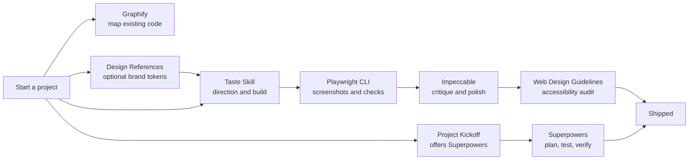

<p align="center">
  
</p>

<p align="center">
  <a href="LICENSE"></a>
  
  
  
</p>

A single, repeatable setup for the global Claude Code toolkit I use for front-end design, engineering workflow and browser work.
Run one script on any machine and every project gets the same skills, with no per-project configuration.

- **Global, not per-project.** Everything lands in your user folder (`~/.claude`), so it is available in every session.
- **Idempotent.** Re-running the script updates what is already installed.
- **Opinionated about weight.** Heavy workflow tooling (Superpowers) is installed but **off by default**, and a small skill reminds you to switch it on when you start a real project.
- **Verified sources.** Each tool is pulled from its upstream repository. Nothing here is vendored except two small skills.
- **Conservative on security.** Tools that copy browser logins or download stealth browsers are left out on purpose. See [Security notes](#security-notes) and [Deliberately not included](#deliberately-not-included).

## Contents

- [Quick start](#quick-start)
- [What you get](#what-you-get)
- [How the pieces work together](#how-the-pieces-work-together)
- [Superpowers: on for real projects only](#superpowers-on-for-real-projects-only)
- [Tool reference](#tool-reference)
- [Security notes](#security-notes)
- [Deliberately not included](#deliberately-not-included)
- [What the installer changes on your machine](#what-the-installer-changes-on-your-machine)
- [Update, verify and uninstall](#update-verify-and-uninstall)
- [Repository layout](#repository-layout)
- [Credits](#credits)

## Quick start

Prerequisites: **Node 22+**, **npm**, **git**, the **`claude` CLI** (Claude Code), and an installed **Chrome, Edge or Chromium**.

```bash
gh repo clone SpicyFalcon619/claude-skills-setup
cd claude-skills-setup
```

| Platform | Command |
|---|---|
| Windows (PowerShell) | `./install.ps1` |
| macOS / Linux | `bash install.sh` |

Then restart Claude Code and run `/impeccable init` once inside each project where you want Impeccable's design context.

## What you get

**Design**

| Tool | Type | One line |
|---|---|---|
| [Taste Skill v2](#taste-skill-v2) | Skill | Art direction for websites and app screens, checked in a real browser |
| [Impeccable](#impeccable) | Skill, agents, hooks | Design commands for critique, polish, animation, typography and more |
| [Web Design Guidelines](#web-design-guidelines) | Skill | UI code audit against 100+ accessibility and UX rules |
| [Design References](#design-references) | Skill and library | Real design systems from 84 well-known brands |
| [Anthropic skills](#anthropic-skills) | Skills | Official skills for themes, canvas art, brand styling, docs and comms |

**Engineering**

| Tool | Type | One line |
|---|---|---|
| [Superpowers](#superpowers-on-for-real-projects-only) | Plugin, off by default | Brainstorm, plan, test-first and verify workflow for real projects |
| [Project Kickoff](#project-kickoff) | Skill (this repo) | Reminds you to turn Superpowers on when a real project starts |
| [Matt Pocock Skills](#matt-pocock-skills) | Plugin | Small, composable skills: TDD, specs, tickets, code review, triage |
| [Karpathy Skills](#karpathy-skills) | Plugin | Four guardrails against common LLM coding mistakes |
| [Graphify](#graphify) | CLI and skill | Turns a codebase into a queryable knowledge graph |

**Browser**

| Tool | Type | One line |
|---|---|---|
| [Playwright CLI](#playwright-cli) | CLI and skill | Token-efficient browser automation, screenshots and test generation |

## How the pieces work together



A typical flow: kick off a real project and turn Superpowers on for it, map an existing codebase with Graphify, pick a direction with Taste Skill (or borrow tokens from a brand in Design References), let Playwright CLI look at the result in a real browser, refine with Impeccable commands such as `critique`, `polish` and `typeset`, then run Web Design Guidelines as the final audit.

## Superpowers: on for real projects only

[Superpowers](https://github.com/obra/superpowers) enforces a disciplined workflow: brainstorm, write a plan, test first, verify before claiming done. That is excellent on a real project and slow overhead on a quick question or a one-off script. So this setup:

1. Installs it as a plugin at user scope.
2. **Disables it globally**, so it adds nothing to everyday sessions.
3. Installs the [`project-kickoff`](#project-kickoff) skill, which notices when you are starting a real project and offers to enable Superpowers for that project only.

Enabling is per project and reversible:

```bash
claude plugin enable  superpowers@claude-plugins-official --scope project   # on, shared via .claude/settings.json
claude plugin enable  superpowers@claude-plugins-official --scope local     # on, private to this machine
claude plugin disable superpowers@claude-plugins-official --scope project   # off again
```

Plugins load at session start, so restart Claude Code after enabling. Cost when enabled is about 850 tokens of always-on context plus a session-start hook. Re-running the installer turns it back off globally, which is intended.

## Tool reference

### Taste Skill v2

**Source:** [Leonxlnx/taste-skill](https://github.com/Leonxlnx/taste-skill) (skill name `design-taste-frontend`)

An anti-generic front-end skill. Instead of the usual centred headline over three icon cards, it deals researched design directions (composition, type system, palette, hero and section blueprints) from a library distilled from 247 curated gallery sites. It then builds, screenshots at several widths in a real browser, critiques against a rubric and fixes.

- Triggers on landing pages, marketing sites, portfolios, product pages, redesigns, and also dashboards and other app screens.
- Ships scripts (draw, inspect, lint, assets) that run on Node 22+ and a local Chrome, Edge or Chromium.
- Finds real, credited images from open archives (Wikimedia, museums, NASA, Internet Archive) and needs no API keys.
- **Does not** replace a component library, and it only activates on web UI work.

### Impeccable

**Source:** [pbakaus/impeccable](https://github.com/pbakaus/impeccable)

A design-direction skill with a command set for each stage of UI work. Invoke it as `/impeccable <command> [target]`.

| Stage | Commands |
|---|---|
| Build | `shape`, `init`, `document`, `extract` |
| Evaluate | `critique`, `audit` |
| Refine | `polish`, `bolder`, `quieter`, `distill`, `harden`, `onboard` |
| Enhance | `animate`, `colorize`, `typeset`, `layout`, `delight`, `overdrive` |
| Fix | `clarify`, `adapt`, `optimize` |
| Iterate | `live`, `generate` |

It also installs four helper agents (asset producer, documenter, finish reviewer, manual edit applier), a small engine binary, and **hooks** in `~/.claude/settings.json` that check UI files after edits and run a deeper pass when Claude stops. Remove the `impeccable` entries from the `hooks` block if you do not want that.

### Web Design Guidelines

**Source:** [vercel-labs/agent-skills](https://github.com/vercel-labs/agent-skills) (skill `web-design-guidelines`)

Reviews UI code against Vercel's Web Interface Guidelines: accessibility, focus states, forms, animation, typography, images, performance, navigation, dark mode and touch interaction. Output is terse `file:line` findings. Trigger it with requests like "review my UI" or "check accessibility".

It fetches the current rule set from the `vercel-labs/web-interface-guidelines` repository each time it runs, so it needs network access.

### Design References

**Source:** [VoltAgent/awesome-design-md](https://github.com/VoltAgent/awesome-design-md), plus a small wrapper skill in this repository ([`design-references/SKILL.md`](design-references/SKILL.md))

A library of 84 `DESIGN.md` files extracted from well-known products, covering colour palettes, type scales, component styles and layout principles. Examples include Stripe, Linear, Vercel, Notion, Apple, Airbnb, Spotify and Supabase. The wrapper skill is what makes it automatic: say "make it feel like Linear" and the agent reads that brand's file before writing UI.

Brand files are inspiration and structure. The skill instructs the agent not to copy logos, wordmarks or proprietary copy.

### Anthropic skills

**Source:** [anthropics/skills](https://github.com/anthropics/skills)

Seven official skills: `algorithmic-art` (generative p5.js art), `brand-guidelines`, `canvas-design` (posters and static art), `doc-coauthoring` (structured document writing), `internal-comms`, `slack-gif-creator` and `theme-factory` (ten preset themes for artifacts, slides and pages).

Only the skills that are not already bundled with Claude are installed, so there are no duplicates. See [Deliberately not included](#deliberately-not-included).

### Project Kickoff

**Source:** this repository ([`project-kickoff/SKILL.md`](project-kickoff/SKILL.md))

Triggers when you begin substantial new work (a new app, service, library or repo, or a feature large enough to need a plan). It checks whether Superpowers is already on, asks once whether to enable it for this project, and runs the per-project enable command on a yes. It also mentions `/impeccable init` for UI projects and `/graphify .` for large existing codebases. It stays silent for quick questions, one-off scripts and small edits.

### Matt Pocock Skills

**Source:** [mattpocock/skills](https://github.com/mattpocock/skills), installed as the `mattpocock-skills` plugin (MIT)

27 small, composable engineering skills, including `tdd`, `to-spec`, `to-tickets`, `triage`, `code-review`, `diagnosing-bugs`, `grill-me`, `grill-with-docs`, `domain-modeling`, `improve-codebase-architecture`, `handoff` and `wayfinder`. They are designed to be adapted rather than to own your process. Always-on context cost is about 1,650 tokens.

### Karpathy Skills

**Source:** [multica-ai/andrej-karpathy-skills](https://github.com/multica-ai/andrej-karpathy-skills), installed as a plugin

One skill, `karpathy-guidelines`, with four principles derived from Andrej Karpathy's notes on LLM coding pitfalls: think before coding, simplicity first, surgical changes, goal-driven execution. About 100 tokens of always-on context. The upstream repository has no license file, so it is installed from source and not copied into this repository.

### Graphify

**Source:** [Graphify-Labs/graphify](https://github.com/Graphify-Labs/graphify) (PyPI package `graphifyy`, Apache-2.0)

Turns a codebase, with its docs, configs and schemas, into a queryable knowledge graph. Run `/graphify .` in a project; the output goes to `graphify-out/` in that project. Code extraction is local and parses ASTs without executing anything. Semantic extraction uses your model backend, so content from the files you point it at is processed by it.

Note: `graphify install` appends a short registration block to your global `~/.claude/CLAUDE.md`. Your existing content is left untouched.

### Playwright CLI

**Source:** [microsoft/playwright-cli](https://github.com/microsoft/playwright-cli)

A command-line browser driver designed to cost fewer tokens than a browser MCP server. Gives the agent navigation, clicking and typing, screenshots, DOM snapshots, console and network inspection, cookie and storage control, video and tracing, device emulation and test generation. The installed skill teaches the agent the commands and ships references for sessions, request mocking, tracing and test generation.

## Security notes

Skills, plugins and hooks run with your user permissions. Nothing sandboxes them from your project `.env` files, `~/.ssh`, browser data or Claude's own history (`~/.claude/history.jsonl` and `~/.claude/projects`). The tools here were chosen and checked with that in mind, but it is worth knowing where the exposure is.

| Exposure | Tool | What to know |
|---|---|---|
| Runs on every session and edit | Impeccable | Its hooks run an opaque compiled engine on session start, after every Edit or Write, and on stop, in all projects. Network use seen in the skill is localhost only. Remove the `impeccable` entries from `~/.claude/settings.json` to run it on demand instead. |
| Fetches instructions at runtime | Web Design Guidelines | It downloads its rule set from a GitHub URL on each run and follows it. That is Vercel's repository, but it is a remote-instruction channel. |
| Runs scripts and a browser | Taste Skill, Playwright CLI | Taste Skill only contacts public image archives. Never point Playwright CLI at your real logged-in browser profile, and treat pages it visits as untrusted. |
| Reads project files | Graphify | It skips `.env`, key files, SSH keys and `.netrc`, but writes `graphify-out/` into the project, so do not commit that on private code. |
| Text only | Pocock, Karpathy, Anthropic skills, Superpowers, the two skills in this repo | No code that touches your data. Superpowers has a session-start hook and is disabled by default. |

Plugins and `npx -y` pull upstream changes without a review, so a trusted repository being compromised later is the main supply-chain risk.

### Hardening snippet (optional, not applied automatically)

[`security/settings.snippet.json`](security/settings.snippet.json) holds the protections I run, so you can merge them into your own `~/.claude/settings.json`:

- **Deny rules** that stop Claude's file tools reading or editing `.env` files and their variants (anywhere on disk), `~/.ssh`, `~/.aws`, `~/.gnupg`, `.npmrc`, `.netrc`, `.pypirc`, `*.pem`, `*.key`, SSH keys, and Claude's own transcripts (`*.jsonl`) and `history.jsonl`. `.env.example` stays readable. Claude's memory folder is deliberately not blocked.
- **Sandbox** for shell commands, with the same credential paths denied to them. `failIfUnavailable` is `false`, so a machine that cannot start the sandbox degrades to a warning, and `autoAllowBashIfSandboxed` is `false`, so prompting is unchanged.

Notes on how it behaves:

- The `//**/` rule form matches anywhere on disk. The plain `**/` form only matches inside the current project, which is why both are included.
- Deny rules restrict Claude's own tools. They do not stop a script that a skill launches, which is what the sandbox is for.
- The sandbox can break tools that need broad file or network access (`git push`, `gh`, `npm`, Playwright). If that happens, delete the `"sandbox"` block.
- Merge by hand into the `permissions` and `sandbox` keys. The installers never touch these settings.

Other steps worth doing:

- Keep real secrets out of project folders, and rotate any key that has sat in an `.env`.
- Turn off plugin auto-update if you want to review changes first.
- Impeccable's hooks are optional. Remove the `impeccable` entries from the `hooks` block to run it on demand only.

## Deliberately not included

Chosen on purpose, so nobody wonders whether they were missed.

| Skipped | Why |
|---|---|
| UI UX Pro Max | Overlaps Taste Skill and Impeccable, and its generic style catalogue works against a non-generic look |
| Caveman | Terse output trades readability for tokens, and it ships a proxy |
| Ponytail | A style preference, not needed |
| Agent Reach | Installs a stealth browser and several third-party tools, can copy login cookies from your Chrome, and copies its skill into every other agent it finds. Installed, reviewed, then removed |
| Image to Code | Written for Codex and depends on an image-generation tool Claude Code does not have |
| Anthropic `frontend-design`, `webapp-testing` | Overlap Taste Skill and Playwright CLI; two design skills compete for the same triggers |
| Anthropic document skills, `mcp-builder`, `skill-creator`, `web-artifacts-builder`, `claude-api` | Already bundled with Claude |

## What the installer changes on your machine

Everything is user-level. Nothing is written inside a project.

| Location | What | Source |
|---|---|---|
| `~/.claude/skills/design-taste-frontend` | Skill | Taste Skill |
| `~/.claude/skills/web-design-guidelines` | Skill | Vercel |
| `~/.claude/skills/playwright-cli` | Skill | Microsoft |
| `~/.claude/skills/impeccable` | Skill and engine binary | Impeccable |
| `~/.claude/skills/design-references` | Wrapper skill | This repo |
| `~/.claude/skills/project-kickoff` | Skill | This repo |
| `~/.claude/skills/graphify` | Skill | Graphify |
| `~/.claude/skills/{algorithmic-art, brand-guidelines, canvas-design, doc-coauthoring, internal-comms, slack-gif-creator, theme-factory}` | Seven skills | Anthropic |
| Claude plugins (user scope) | `mattpocock-skills`, `andrej-karpathy-skills`, `superpowers` (disabled) | Pocock, Karpathy, Superpowers |
| `~/.claude/agents/impeccable-*.md` | Four agents | Impeccable |
| `~/.claude/settings.json` | Impeccable hooks, plugin and marketplace entries | Impeccable, Claude CLI |
| `~/.claude/CLAUDE.md` | A short Graphify registration block appended | Graphify |
| npm global | `@playwright/cli` | Microsoft |
| `uv` tool | `graphify`, `graphify-mcp` (and `uv` itself if missing, in `~/.local/bin`) | Graphify |
| `~/design-references/awesome-design-md` | Brand library (git clone) | VoltAgent |
| `~/.playwright` | Playwright workspace | Microsoft |

The skills CLI shows third-party security scores at install time. Review a skill before trusting it: skills run with your agent's permissions.

## Update, verify and uninstall

**Update:** `git pull` in this repo, then re-run the install script. It refreshes each tool and pulls the latest brand library.

**Verify:**

```bash
ls ~/.claude/skills
claude plugin list           # mattpocock-skills and karpathy enabled, superpowers disabled
playwright-cli --version
graphify --help
```

Inside Claude Code, the skills appear in the available-skills list after a restart.

**Uninstall:**

```bash
rm -rf ~/.claude/skills/{design-taste-frontend,web-design-guidelines,playwright-cli,impeccable,design-references,project-kickoff,graphify,algorithmic-art,brand-guidelines,canvas-design,doc-coauthoring,internal-comms,slack-gif-creator,theme-factory}
rm -f  ~/.claude/agents/impeccable-*.md
rm -rf ~/design-references
npm uninstall -g @playwright/cli
uv tool uninstall graphifyy
claude plugin uninstall mattpocock-skills@claude-plugins-official
claude plugin uninstall andrej-karpathy-skills@karpathy-skills
claude plugin uninstall superpowers@claude-plugins-official
```

Then remove the `impeccable` entries from the `hooks` block in `~/.claude/settings.json` and the `# graphify` block from `~/.claude/CLAUDE.md`.

## Repository layout

```
claude-skills-setup/
  install.ps1                 Windows installer (PowerShell)
  install.sh                  macOS / Linux installer (bash)
  design-references/
    SKILL.md                  Wrapper skill over the brand library
  project-kickoff/
    SKILL.md                  Reminds you to enable Superpowers on real projects
  security/
    settings.snippet.json     Optional deny rules and sandbox settings to merge by hand
  assets/
    banner.svg                README banner
  LICENSE
```

## Credits

All the heavy lifting is upstream: [Taste Skill](https://github.com/Leonxlnx/taste-skill), [Impeccable](https://github.com/pbakaus/impeccable), [Vercel agent-skills](https://github.com/vercel-labs/agent-skills), [Playwright CLI](https://github.com/microsoft/playwright-cli), [awesome-design-md](https://github.com/VoltAgent/awesome-design-md), [Anthropic skills](https://github.com/anthropics/skills), [Superpowers](https://github.com/obra/superpowers), [Matt Pocock Skills](https://github.com/mattpocock/skills), [Karpathy Skills](https://github.com/multica-ai/andrej-karpathy-skills) and [Graphify](https://github.com/Graphify-Labs/graphify). This repository only wires them together.

Released under the [MIT License](LICENSE).
