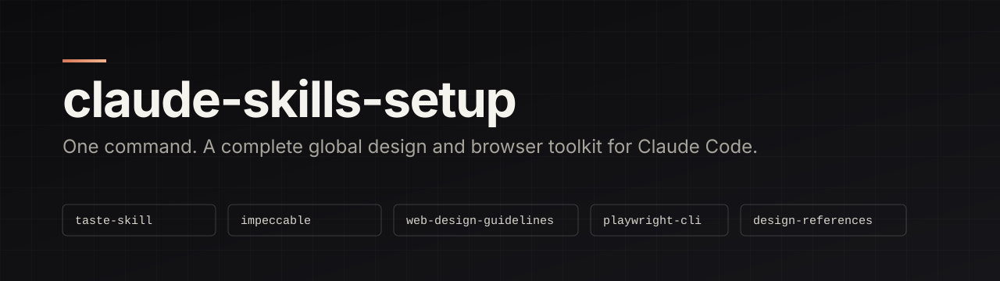
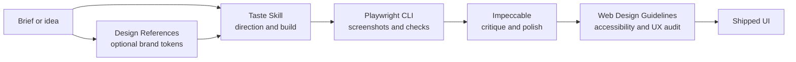

<p align="center">
  
</p>

<p align="center">
  <a href="LICENSE"></a>
  
  
  
</p>

A single, repeatable setup for the global Claude Code toolkit I use for front-end design and browser work.
Run one script on any machine and every project gets the same skills, with no per-project configuration.

- **Global, not per-project.** Everything lands in your user folder (`~/.claude`), so it is available in every session.
- **Idempotent.** Re-running the script updates what is already installed.
- **Verified sources.** Each tool is pulled from its upstream repository. Nothing here is vendored except one small wrapper skill.
- **Opt-in extras.** Anything with a wider security footprint is behind an explicit flag.

## Contents

- [Quick start](#quick-start)
- [What you get](#what-you-get)
- [How the pieces work together](#how-the-pieces-work-together)
- [Tool reference](#tool-reference)
- [Optional: Agent Reach](#optional-agent-reach)
- [What the installer changes on your machine](#what-the-installer-changes-on-your-machine)
- [Update, verify and uninstall](#update-verify-and-uninstall)
- [Repository layout](#repository-layout)
- [Credits](#credits)

## Quick start

Prerequisites: **Node 22+**, **npm**, **git**, and an installed **Chrome, Edge or Chromium**.

```bash
gh repo clone SpicyFalcon619/claude-skills-setup
cd claude-skills-setup
```

| Platform | Command |
|---|---|
| Windows (PowerShell) | `./install.ps1` |
| macOS / Linux | `bash install.sh` |

Add `-WithAgentReach` (PowerShell) or `--with-agent-reach` (bash) to include the optional extra described [below](#optional-agent-reach).

Then restart Claude Code and run `/impeccable init` once inside each project where you want Impeccable's design context.

## What you get

| Tool | Type | One line |
|---|---|---|
| [Taste Skill v2](#taste-skill-v2) | Skill | Art direction for websites and app screens, checked in a real browser |
| [Impeccable](#impeccable) | Skill, agents, hooks | Design commands for critique, polish, animation, typography and more |
| [Web Design Guidelines](#web-design-guidelines) | Skill | UI code audit against 100+ accessibility and UX rules |
| [Playwright CLI](#playwright-cli) | CLI and skill | Token-efficient browser automation, screenshots and test generation |
| [Design References](#design-references) | Skill and library | Real design systems from 84 well-known brands |
| [Agent Reach](#optional-agent-reach) | CLI and skill, opt-in | Let the agent read web, video and social platforms |

## How the pieces work together



A typical flow: pick a direction with Taste Skill (or borrow tokens from a brand in Design References), let Playwright CLI look at the result in a real browser, refine with Impeccable commands such as `critique`, `polish` and `typeset`, then run Web Design Guidelines as the final audit.

## Tool reference

### Taste Skill v2

**Source:** [Leonxlnx/taste-skill](https://github.com/Leonxlnx/taste-skill) (skill name `design-taste-frontend`)

An anti-generic front-end skill. Instead of the usual centred headline over three icon cards, it deals researched design directions (composition, type system, palette, hero and section blueprints) from a library distilled from 247 curated gallery sites. It then builds, screenshots at several widths in a real browser, critiques against a rubric and fixes.

- Triggers on landing pages, marketing sites, portfolios, product pages, redesigns, and also dashboards and other app screens.
- Ships scripts (draw, inspect, lint, assets) that run on Node 22+ and a local Chrome, Edge or Chromium.
- Finds real, credited images from open archives (Wikimedia, museums, NASA, Internet Archive) and needs no API keys.
- **Does not** replace a component library, and it only activates on web UI work.

### Impeccable

**Source:** [pbakaus/impeccable](https://github.com/pbakaus/impeccable)

A design-direction skill with a command set for each stage of UI work. Invoke it as `/impeccable <command> [target]`.

| Stage | Commands |
|---|---|
| Build | `shape`, `init`, `document`, `extract` |
| Evaluate | `critique`, `audit` |
| Refine | `polish`, `bolder`, `quieter`, `distill`, `harden`, `onboard` |
| Enhance | `animate`, `colorize`, `typeset`, `layout`, `delight`, `overdrive` |
| Fix | `clarify`, `adapt`, `optimize` |
| Iterate | `live`, `generate` |

It also installs four helper agents (asset producer, documenter, finish reviewer, manual edit applier), a small engine binary, and **hooks** in `~/.claude/settings.json` that check UI files after edits and run a deeper pass when Claude stops. Remove the `impeccable` entries from the `hooks` block if you do not want that.

### Web Design Guidelines

**Source:** [vercel-labs/agent-skills](https://github.com/vercel-labs/agent-skills) (skill `web-design-guidelines`)

Reviews UI code against Vercel's Web Interface Guidelines: accessibility, focus states, forms, animation, typography, images, performance, navigation, dark mode and touch interaction. Output is terse `file:line` findings. Trigger it with requests like "review my UI" or "check accessibility".

It fetches the current rule set from the `vercel-labs/web-interface-guidelines` repository each time it runs, so it needs network access.

### Playwright CLI

**Source:** [microsoft/playwright-cli](https://github.com/microsoft/playwright-cli)

A command-line browser driver designed to cost fewer tokens than a browser MCP server. Gives the agent navigation, clicking and typing, screenshots, DOM snapshots, console and network inspection, cookie and storage control, video and tracing, device emulation and test generation. The installed skill teaches the agent the commands and ships references for sessions, request mocking, tracing and test generation.

### Design References

**Source:** [VoltAgent/awesome-design-md](https://github.com/VoltAgent/awesome-design-md), plus a small wrapper skill in this repository ([`design-references/SKILL.md`](design-references/SKILL.md))

A library of 84 `DESIGN.md` files extracted from well-known products, covering colour palettes, type scales, component styles and layout principles. Examples include Stripe, Linear, Vercel, Notion, Apple, Airbnb, Spotify and Supabase. The wrapper skill is what makes it automatic: say "make it feel like Linear" and the agent reads that brand's file before writing UI.

Brand files are inspiration and structure. The skill instructs the agent not to copy logos, wordmarks or proprietary copy.

## Optional: Agent Reach

**Source:** [Panniantong/Agent-Reach](https://github.com/Panniantong/Agent-Reach) (MIT, actively maintained)

Gives an agent a single CLI for reading platforms it cannot normally reach: GitHub, YouTube (including transcripts), Bilibili, V2EX and web pages by default, with optional Reddit, LinkedIn, X, Xiaohongshu, Xueqiu and others. It is read-only by design (it searches and reads, and does not post).

It is **not installed by default**, because its security footprint is wider than the rest of this toolkit:

- It installs a chain of third-party tools: `uv`, a stealth Chromium build (CloakBrowser), OpenCLI with a Chrome extension, `yt-dlp` and per-platform CLIs.
- For login-gated platforms it can copy a site's login cookies from your Chrome into its own dedicated browser. If you use those channels, use a secondary account.
- Several channels exist to get past platforms' anti-automation defences, which can breach those platforms' terms and get accounts restricted.
- It feeds untrusted web content (posts, comments, pages) to your agent, which is a prompt-injection surface.
- The PyPI package named `agent-reach` is a different project. This repository installs it from the official GitHub release only.

Recommended use: install it, and use only the default channels that need no login (`github`, `youtube`, `web`, `v2ex`, `bilibili` search). Add login channels only with a throwaway account. Remove with "Uninstall Agent Reach" in a session, or `agent-reach` commands per its docs.

```bash
./install.ps1 -WithAgentReach        # Windows
bash install.sh --with-agent-reach   # macOS / Linux
```

## What the installer changes on your machine

Everything is user-level. Nothing is written inside a project.

| Location | What | Source |
|---|---|---|
| `~/.claude/skills/design-taste-frontend` | Skill | Taste Skill |
| `~/.claude/skills/web-design-guidelines` | Skill | Vercel |
| `~/.claude/skills/playwright-cli` | Skill | Microsoft |
| `~/.claude/skills/impeccable` | Skill and engine binary | Impeccable |
| `~/.claude/skills/design-references` | Wrapper skill | This repo |
| `~/.claude/agents/impeccable-*.md` | Four agents | Impeccable |
| `~/.claude/settings.json` | Impeccable hooks added | Impeccable |
| npm global | `@playwright/cli` | Microsoft |
| `~/design-references/awesome-design-md` | Brand library (git clone) | VoltAgent |
| `~/.playwright` | Playwright workspace | Microsoft |
| `~/.agent-reach`, `uv` tools | Only with the opt-in flag | Agent Reach |

The skills CLI shows third-party security scores at install time. Review a skill before trusting it: skills run with your agent's permissions.

## Update, verify and uninstall

**Update:** `git pull` in this repo, then re-run the install script. It refreshes each tool and pulls the latest brand library.

**Verify:**

```bash
ls ~/.claude/skills          # five skills (plus agent-reach if opted in)
playwright-cli --version
```

Inside Claude Code, the skills appear in the available-skills list after a restart.

**Uninstall:**

```bash
rm -rf ~/.claude/skills/{design-taste-frontend,web-design-guidelines,playwright-cli,impeccable,design-references}
rm -f  ~/.claude/agents/impeccable-*.md
rm -rf ~/design-references
npm uninstall -g @playwright/cli
```

Then remove the `impeccable` entries from the `hooks` block in `~/.claude/settings.json`.

## Repository layout

```
claude-skills-setup/
  install.ps1                 Windows installer (PowerShell)
  install.sh                  macOS / Linux installer (bash)
  design-references/
    SKILL.md                  Wrapper skill over the brand library
  assets/
    banner.svg                README banner
  LICENSE
```

## Credits

All the heavy lifting is upstream: [Taste Skill](https://github.com/Leonxlnx/taste-skill), [Impeccable](https://github.com/pbakaus/impeccable), [Vercel agent-skills](https://github.com/vercel-labs/agent-skills), [Playwright CLI](https://github.com/microsoft/playwright-cli), [awesome-design-md](https://github.com/VoltAgent/awesome-design-md) and [Agent Reach](https://github.com/Panniantong/Agent-Reach). This repository only wires them together.

Released under the [MIT License](LICENSE).
